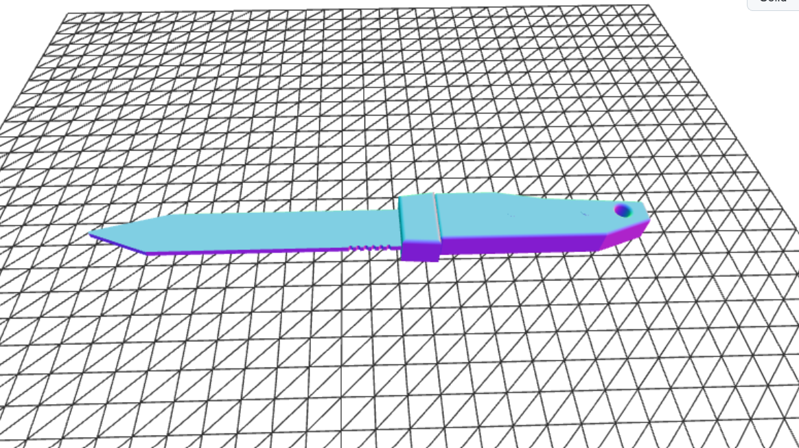

# 3D-Generator

A desktop app that generates 3D-printable models from a text description. It uses the Gemini API to write [CadQuery](https://github.com/CadQuery/cadquery) code, runs it, and exports the result as an STL file.



## Features

- **Text to 3D:** describe an object and get a ready-to-print `modell.stl`
- **Random model:** generates a simple random object (cup, penholder, hook, vase, paper towel holder, geometric figure)
- **Simple GUI** built with Tkinter
- **Error handling** for overloaded servers and invalid generated code

## How it works

1. You enter a description (or press **Random Modell**).
2. Gemini returns CadQuery Python code.
3. The app executes the code and takes the object stored in the `result` variable.
4. The model is exported to `modell.stl`, which you can open in any slicer.

## Requirements

- Python 3.10+
- A [Gemini API key](https://aistudio.google.com/apikey)

## Installation

```bash
git clone https://github.com/lacko186/3D-Generator.git
cd 3D-Generator
pip install cadquery python-dotenv google-genai
```

Create a `.env` file in the project folder:

```env
GEMINI_API_KEY=your_api_key_here
```

## Usage

```bash
python main.py
```

1. Type what you want to create, e.g. `a cup with a handle, 80 mm tall`.
2. Click **Generálás** to generate it, or **Random Modell** for a surprise.
3. Find the result in the project folder as `modell.stl`.

## Tips

- Keep descriptions simple and give dimensions in millimetres.
- If generation fails, try again or rephrase: the AI occasionally writes invalid CadQuery code.
- Each new generation overwrites the previous `modell.stl`.

## Security note

The app runs AI-generated Python code with `exec()`. Only use it with your own prompts and on a machine you trust.

## License

Add your license here (e.g. MIT).
